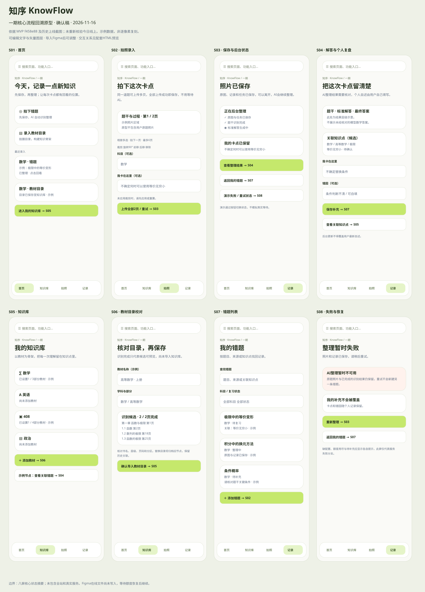

# KnowFlow 一期核心流程原型

2026-11-16 用户确认。本稿根据 MVP 一期源码（核查基线 `f458e88`）与历史上线截图回溯整理，不作为开发前完成原型或今日线上逐像素复刻的证据。

## 查看

- [八屏矢量总览](core-flow.svg)：GitHub 可预览，SVG 可导入 Figma；导入后的文字可编辑效果尚未验证。
- [可点击原型](core-flow.html)：下载后用浏览器打开，点击按钮与卡片演示跳转。GitHub 文件页不会执行 HTML。
- [对应 PRD](../../prd/PRD.md)。

## 覆盖范围

| 页面 | 内容 |
| --- | --- |
| S01 | 手机首页与核心录入入口 |
| S02 | 多页拍照与错题保存 |
| S03 | 已保存、排队与后台整理 |
| S04 | 标准解答层级、知识关联与个人复盘 |
| S05 | 知识库 |
| S06 | 教材目录候选校对与确认 |
| S07 | 错题筛选与找回 |
| S08 | 整理失败与重试 |

已检查八屏显示、横向溢出，并走通 S01→S02→S03→S04→S07 的本地演示跳转。表单与状态为演示，不保存学习资料、不上传文件、不调用 AI；并非产品业务测试。

示例题目、教材与数量不是用户规模或产品效果数据。布局保留奶白、青柠绿及实际导航，做了核心状态摘要；不包含全站桌面、登录、笔记和设置。旧原型图片留在上级目录，属于其他历史参考，不覆盖本次核心流程。

## Figma 状态

Figma 文件已创建，但写入八屏时触发 Starter 工具调用额度限制，在线页面尚未完成；不能将空文件链接当作完成成果。当前交付是此目录的 HTML 与 SVG。后续补建可编辑屏幕与原型连线后再补正式 Figma 链接。
